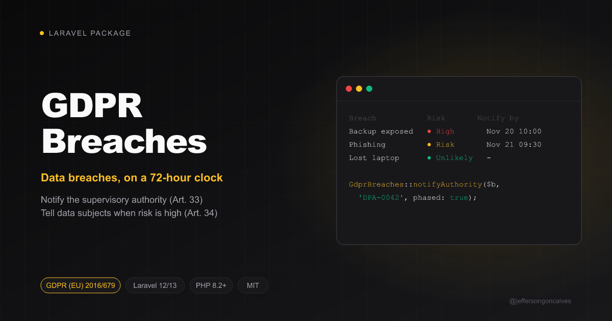

# Laravel GDPR Breaches



[](https://packagist.org/packages/jeffersongoncalves/laravel-gdpr-breaches)
[](https://github.com/jeffersongoncalves/laravel-gdpr-breaches/actions/workflows/tests.yml)
[](https://packagist.org/packages/jeffersongoncalves/laravel-gdpr-breaches)

Personal data breach register for the EU General Data Protection Regulation (GDPR, Arts. 33 and 34). It is part of the [laravel-gdpr](https://github.com/jeffersongoncalves/laravel-gdpr) suite.

- **72-hour clock:** the deadline to notify the supervisory authority counts from when you became aware of the breach (Art. 33(1)). A later notice must give the reasons for the delay, and the package refuses one without them.
- **Risk assessment:** a breach that is `unlikely` to result in a risk is documented but not notified. A breach that is a `risk` must be notified to the authority. A `high` risk also has to be communicated to the data subjects (Art. 34(1)).
- **Phased notification:** when you don't have all the information yet, notify what you have and send the rest later (Art. 33(4)). The register tracks what is still owed.
- **Exemptions from telling the data subjects:** encrypted data, measures that make the risk unlikely, or a public communication instead (Art. 34(3)). You record the reason.
- **Every breach is documented,** notified or not (Art. 33(5)).

> This package gives you tooling. It does not make you compliant on its own. Your breach response plan needs legal review.

## Installation

```bash
composer require jeffersongoncalves/laravel-gdpr-breaches
php artisan vendor:publish --tag="gdpr-breaches-migrations"
php artisan migrate
```

## Usage

```php
use JeffersonGoncalves\GdprBreaches\Enums\Risk;
use JeffersonGoncalves\GdprBreaches\Facades\GdprBreaches;

$breach = GdprBreaches::open('Backup bucket exposed', discoveredAt: now(), attributes: [
    'description' => 'A storage bucket with database backups was public for 2 days.',
    'occurred_at' => now()->subDays(2),
    'data_categories' => ['name', 'email', 'order history'],
    'affected_subjects' => 1200,
    'affected_records' => 5400,
    'consequences' => 'Phishing targeting customers.',
]);

$breach->due_at;                                    // discovered_at + 72 hours

GdprBreaches::assess($breach, Risk::High, 'Bucket closed, keys rotated.');
GdprBreaches::notifyAuthority($breach, 'DPA-2026-0042', phased: true);   // the rest of the information follows
GdprBreaches::sendFurtherInformation($breach);
GdprBreaches::notifySubjects($breach);              // or skipSubjectNotice($breach, 'Data was encrypted (Art. 34(3)(a)).')
GdprBreaches::close($breach);
```

Notifying after the deadline:

```php
GdprBreaches::notifyAuthority($breach, 'DPA-2026-0043', delayReason: 'Forensics were needed to confirm that personal data was involved.');
```

### Queries

```php
$breach->owesAuthorityNotice();
$breach->owesSubjectNotice();
$breach->owesFurtherInformation();
$breach->isOverdue();

Breach::query()->scopes('pending')->get();   // something still owed
Breach::query()->scopes('overdue')->get();   // authority not notified within 72 hours
```

### Deadline alerts

```php
// routes/console.php
Schedule::command('gdpr:breaches-overdue')->hourly();
```

The command dispatches `BreachOverdue` for each breach past the 72 hours. `BreachOpened` is dispatched when a breach is registered. Use it to start your response plan.

## Testing

```bash
composer test
```

## Changelog

See [CHANGELOG](CHANGELOG.md).

## License

The MIT License (MIT). See [License File](LICENSE.md).
